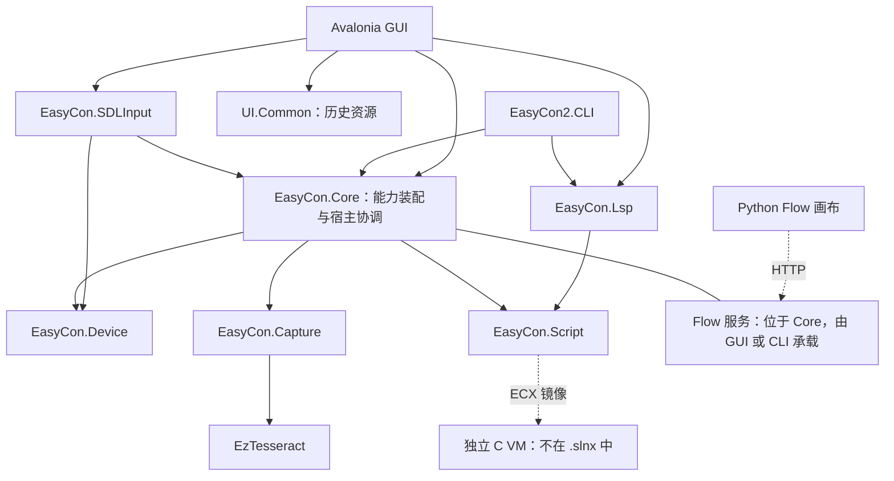
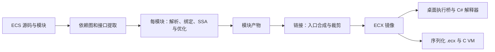

# EasyCon 功能、模块架构与 Cleanroom 重建规格

> 状态：现状分析与功能级重建规格。日期：2026-10-21。
> 代码基线：`85c0dba57455ef84a1b04db5928b7cce8c33fef4`。
> 读者：需要理解、维护或独立重建同类系统的工程师。

## 1. 范围与证据口径

EasyCon 将桌面端的游戏画面、游戏音频和脚本决策转换为 Nintendo Switch 手柄输入。其主体是可编程自动化宿主，宝可梦等游戏的具体任务通常由用户脚本与标签实现。

本文根据当前仓库源码、项目引用、测试和现状文档整理。这里的 cleanroom 指提炼功能、输入输出、模块边界与验收行为；分析过程已阅读原实现，**不能据此声称实施了源码隔离的 clean-room 流程**。文中的重建设计允许替换技术栈，不要求复刻类名、目录或算法代码。

范围分为三层：

| 层次 | 本文覆盖 | 交付边界 |
|---|---|---|
| 功能等价 | 用户操作、运行生命周期、感知与控制、失败行为 | 可作为重建任务拆分和黑盒验收的起点 |
| 文件与服务兼容 | 主要文件种类、Flow JSON、HTTP 和工具契约 | 覆盖关键结构；所有参数与完整语言语法仍需专门规格 |
| 二进制与硬件兼容 | ECX 执行模型、格式约束、串口链路摘要 | 不包含完整 ISA、容器偏移表、全部串口命令和固件实现，不能单凭本文完成位级兼容 |

标记约定：**已接入**表示存在产品调用路径；**受限**表示有平台、配置或素材前提；**计划**表示尚未构成产品路径。代码中存在测试不等于本次已经执行，实际验证范围见第 16 节。来源编号见第 17 节。

## 2. 已实现功能与产品边界

| 编号 | 功能 | 用户可观察行为 | 状态与限制 |
|---|---|---|---|
| F01 | 桌面工作台 | 脚本编辑、文件树、运行日志、连接管理、视频监看、标签编辑、配置窗口 | 已接入 Avalonia GUI；采用 MVVM 与按功能组织的目录 |
| F02 | 手柄控制 | 屏幕虚拟手柄、键盘映射、实体手柄映射；输出按键、方向键、摇杆和 Amiibo 操作 | 已接入；生产输入后端为 SDL3，目标设备经串口连接 |
| F03 | 视频采集 | 枚举、选择、连接来源，显示当前画面，截图和裁剪 ROI | 已接入；来源身份、帧号和连接代次随帧发布 |
| F04 | 图像标签 | 加载旧图像标签、预览匹配、脚本按名称查询分数 | 已接入 Maa 适配；普通匹配仍有同帧旧算法确认，透明和边缘方法使用兼容扩展 |
| F05 | OCR | 脚本识别、图节点识别、ROI 文字识别与置信度查询 | 受限；Tesseract、PP-OCR 与 Maa profile 的可用性由具体宿主装配决定 |
| F06 | 模型推理 | 通过 ECS 的 NET 系列函数调用 ONNX/DNN、处理输出 | 已接入能力端口与 OpenCV DNN；需要可用模型、输入与后处理约定 |
| F07 | ECS 语言 | 变量、类型、条件、循环、函数、数组、结构体、模块、标准库、外部函数，以及按键和识图语句 | 已接入统一编译与执行链；桌面、MCU 的宿主能力不同 |
| F08 | 模块与缓存 | IMPORT、入口目录的 lib 自动导入、模块独立编译、接口与错误缓存 | 已接入；编译档位只区分缓存策略 |
| F09 | 字节码执行 | C# 桌面解释器和独立 C VM 执行 ECX 镜像；CLI 导出 `.ecx` | 已接入；GUI 一键编译并烧录仍未接通 |
| F10 | Flow 编排 | 拖拽节点、保存图、整图运行、停止、单节点试跑、查看输出与计时 | 已接入；仅在 PC 运行，不编译为 MCU 图程序 |
| F11 | AI 助手 | 流式对话、工具调用、脚本缓冲区编辑、工作区文件操作、感知与经确认的设备动作 | GUI 已接入；CLI `agent` 当前注册工作区文件工具，能力集合较小 |
| F12 | MCP 集成 | GUI 导出 loopback HTTP MCP，CLI 导出 stdio MCP；GUI 可管理外部 MCP 连接 | 已接入；默认不导出要求确认的工具；图像附件不在当前导出适配器中传输 |
| F13 | 游戏音频与声音标签 | 选择输入、查看电平、录制或裁剪声音、保存标签、试听、实时匹配，脚本后台监听与读峰值 | 受限；实时采集与试听使用 Windows WASAPI，CLI 和 MCU 未装配声音识别能力 |
| F14 | 通知与配置 | ALERT、推送列表、QQ 图文通知、配置持久化、错误备份和运行报告 | 已接入；通知失败写日志，外部渠道仍依赖凭据与网络 |
| F15 | 开发工具 | CLI 编译、格式化、IR 和模块分析；LSP 补全、悬浮、定义和文档符号 | 已接入；LSP 分析复用语法树，未与完整项目编译语义统一 |

主程序以 .NET 10 为目标；GUI 使用 Avalonia；图像与推理使用 OpenCvSharp5，OCR 包括手写 Tesseract/Leptonica 绑定。Flow 画布是独立的 Python/PySide6/NodeGraphQt 应用，由 uv 管理。C VM 使用 C99。语言版本以各项目声明为准，例如 Device 显式使用 C# 13，不能把全仓描述为同一个语言档位。[E01][E02][E03][E08][E10][E11]

## 3. 模块架构

### 3.1 当前项目依赖

下图箭头表示项目引用方向；HTTP 连线表示进程间调用。它描述当前实现，不是要求重建系统复制的目录结构。



`EasyCon.Core` 是能力端口与组合根所在层，同时包含运行桥、Flow、AI、Maa、配置和通知。底层的 Script、Device、EzTesseract 没有项目引用；Capture 引用 EzTesseract，因此 Capture 并非严格的零引用项目。LSP 直接引用 Script，未引用 Core。[E01]

### 3.2 模块职责和可替换边界

| 模块 | 当前职责 | 输入与输出 | 重建时应保留的边界 |
|---|---|---|---|
| 桌面宿主 | 编辑器、连接界面、监看、窗口生命周期、交互确认 | 用户意图与配置 → 服务调用、状态和日志 | ViewModel 不依赖控件；业务动作通过服务或端口调用 |
| CLI 宿主 | 命令解析、无头运行、标准输出、退出码、服务承载 | 文件与参数 → 产物、报告或进程服务 | 复用编译器和宿主库，避免另写一份运行语义 |
| 能力装配 | 将原始设备、帧、OCR、环境等组装成一次运行可用的能力 | 宿主上下文 → 能力集合与资源租约 | 默认值、适配、所有权集中定义 |
| Script | 词法、语法、绑定、SSA、优化、模块图、链接、编码、桌面解释器 | ECS → 诊断、接口、模块产物与 ECX | 不反向依赖设备、GUI 或 Core |
| Device | 连接探测、设备命令、报告编码、队列与写出 | 逻辑输入 → 串口字节与连接事件 | 通信接口可注入假连接，协议与 UI 分离 |
| SDLInput | SDL 事件、映射、键位配置、实体手柄检测 | 键盘/手柄事件 → 逻辑输入 | 单元测试不启动原生事件循环 |
| Capture | 视频生产、帧存储、图像处理、OCR 引擎、音频采集和匹配 | 原生数据 → 帧租约、图像结果、音频块与分数 | 发布不可变身份；持有原生资源者负责释放 |
| Maa 宿主适配 | 控制器会话、帧中心、运行停止域、标签转换与识别资源 | 设备与旧标签 → 受租约约束的输入和识别调用 | Maa 状态与业务状态分别记录，旧标签兼容契约显式化 |
| Flow | 图模型、节点目录、节点语义、执行器、服务状态、HTTP/工具适配 | 图与能力 → 执行报告 | 节点目录由后端维护；前端不执行节点业务 |
| AI 与工具 | 模型客户端、上下文组装、技能、工具调度、MCP 导出 | 对话与工具 schema → 文本、工具结果和交互事件 | 工具依赖能力或窄端口；确认、视觉与并发资格属于工具元数据 |
| LSP | 文档同步、语法分析与编辑辅助 | 文档快照 → 诊断、补全、符号与跳转 | 编辑反馈与执行编译分开维护；不能假定两者完全等价 |
| 配置与通知 | 用户配置、迁移、持久化、推送与发送结果 | 设置/ALERT → 配置文件、通知队列与日志 | 保存失败可报告；通知队列不阻塞主脚本决策 |
| C VM | 镜像加载、值与对象池、指令执行、宿主回调 | ECX 与宿主 ABI → 执行结果和错误现场 | 保持 C# 与 C 的可观察语义，不要求共享内部内存布局 |

架构采用显式构造和依赖传递，没有 DI 容器。GUI 在 `App.axaml.cs` 创建应用级对象；CLI 在命令入口装配。核心运行链通过端口隔离宿主，但 Core 本身仍是依赖 Maa/OpenCV 等运行库的综合库，并不是可脱离这些依赖部署的轻量抽象包。[E01][E02][E04][E07]

### 3.3 重建系统的逻辑分层

建议把重建目标拆成六个逻辑单元：交互宿主、运行协调器、编译执行器、感知服务、输入服务、持久化与观测。Flow 和 Agent 作为两种编排方式，共用这些单元。

此分法是重建设计建议。它不要求先拆分当前项目，也不改变现有组合根约束。若在原仓库继续开发，能力组装仍应收敛到 `ScriptHostAssembler`，编译选项仍应使用 `ScriptCompileProfiles`。[E02]

## 4. 三条主要执行路径

### 4.1 用户运行 ECS

1. 取得编辑器内容或脚本文件，以及入口路径和标签目录。
2. 编译完整模块项目，返回诊断、镜像、符号、时序信息和能力需求。
3. 编译错误留在准备阶段；从链接后镜像判断按键、实时采集、实际标签引用等需求。
4. 为引用的旧标签准备 Maa 资源 generation 并预检；只在需要时取得输入或采集租约。
5. 宿主提交设备、帧、日志、OCR 等原料，能力装配器创建本次执行上下文。
6. 运行桥将能力转换为解释器宿主回调，执行 ECX。
7. 正常结束、取消或异常均进入清理；释放输入、停止本轮音频识别、归还帧及资源租约，并报告结果。

CLI `run` 与 GUI 的脚本运行共用编译和能力装配，但装配的能力并不完全相同。例如 GUI 提供已连接的音频源和脚本目录，当前 CLI `run` 没有提供这两个音频原料。[E02][E04][E08]

### 4.2 用户运行 Flow

画布从后端取得节点目录，保存或提交图 JSON；后端创建运行 ID、装配能力，沿 exec 边依次执行节点。数据输入按引用惰性求值，复杂逻辑交给 ECS 节点。服务保存状态、事件、节点输出和耗时；画布轮询并显示结果。

GUI 内嵌服务与监看面板共用同一采集和控制器实例。独立 `serve` 使用自己的宿主。二者均复用 Core 的图执行实现；Python 画布仅编辑图与调用 API。[E03][E09]

### 4.3 AI 驱动工作区或设备

对话先结合模型配置、项目上下文、技能和工具 schema 形成请求，再接收流式文本与工具调用。调度器按工具元数据检查视觉能力、确认需求与并发资格，执行后把结构化结果送回下一轮。

GUI 工具集可编辑缓冲区、编译运行脚本、读工作区、抓帧及驱动设备。CLI `agent` 当前显式注册工作区文件工具；CLI 的 `--mcp` 入口又注册了文件、技能查询与 Flow 工具。因此“共用编排器”不等于“所有入口工具完全相同”。[E10][E11]

## 5. 运行与资源契约

### 5.1 能力集合

| 能力 | 行为 | 典型提供者 |
|---|---|---|
| Input | 点击、按住、释放、摇杆、Amiibo | 运行绑定的控制器适配器，或显式 mock |
| Console | PRINT、ALERT 等宿主输出 | GUI 日志或 CLI 输出适配器 |
| Environment | 参数、应用目录和环境信息 | 装配器生成的环境对象 |
| Files | 文件读写 | 默认桌面文件系统，或宿主替换实现 |
| Capture | 截图、ROI 和帧号 | 共享帧中心或取帧委托 |
| Vision | 标签匹配与图像处理 | Maa 标签服务或委托适配器 |
| Ocr | 初始化、识别与置信度 | Tesseract、PP-OCR 或显式 Maa profile |
| Inference | 模型载入、输入设置、推理和结果读取 | 默认 DNN 服务，或宿主替换实现 |
| Audio | 为每次脚本创建声音标签识别会话 | 借用 GUI 已有音频输入的服务 |

缺省装配规则需要保持一致：环境和桌面文件系统有默认实现；OCR/DNN 默认可装配但能关闭；输入和实时画面不能凭空创建；音频源不由脚本自行连接。OCR/DNN 的接管或借用通过租约表达，嵌套脚本结束时不能释放外层仍使用的服务。[E02]

“端口为空”与“执行时如何处理”是两层契约。部分 VM syscall 有历史缺省值，严格能力模式会拒绝缺失能力；L1 按键操作不走普通 syscall 缺省表。当前桌面桥仍创建按键回调，并在 Input 为空时跳过实际调用，因此不能把“未提供 Input”统一描述为“按键必然报错”。声音识别缺能力必须明确拒跑，不能返回代表未命中的 0。[E05][E08]

### 5.2 输入所有权与停止

一次运行记录自己的运行 ID、连接代次、输入所有者及取消原因。正在运行的旧任务不能在设备重连后继续把输入送往新连接。输入结束清理需要清队列并发送中立状态；清理结果区分已完成与未确认。

业务成功、原生任务状态、输入清理结果分别记录。取消原因包括用户停止、时限、设备丢失、采集丢失和宿主关闭。即使业务执行完成，释放未确认也会把最终结果标为失败。这里的确认不能解释为游戏已经接收并处理输入，设备写出与游戏响应仍是不同事件。[E04]

### 5.3 帧身份与规范化

每帧带来源 ID、来源代次、帧号、单调接收时刻、原始尺寸、规范化尺寸、规范化规则 ID 和像素格式。时间表示宿主收到数据的时刻，不是相机曝光时间。

当前实时采集将输入明确裁剪、旋转并转为 1920×1080 BGR8；仅支持 0/90/180/270 度旋转，非 16:9 内容需要显式裁剪，不自动猜黑边或拉伸。一次识别固定借用同一帧，坐标与偏移基于该帧解释。已有图像的 ROI 操作不应强制要求连接采集卡。[E06][E07]

## 6. ECS 编译、模块与双端执行

### 6.1 编译模型



语言是行式、带类型的自动化语言，变量以 `$` 开头，支持 Unicode 名称，名称大小写有意义。关键字支持规定的大写或小写形式。按键与等待有专门语句，图像标签可作为表达式中的外部名称查询。PRINT 采用历史文本片段语义，不能假定它接受任意普通表达式。完整语法应另从语言规格与 parser 用例提取。[E05]

模块编译只绑定本模块源码，依赖通过接口提供。接口包含函数签名和默认值载荷、结构体字段、外部函数信息、标签名称及初始化标记；模块私有全局变量不成为导出。入口自动导入同目录 `lib/*.ecs`，显式 IMPORT 按声明文件位置解析，显式导入环给出诊断。[E05]

### 6.2 缓存与链接

缓存键包含源码、必要的路径上下文、直接依赖的接口哈希、编译器版本及影响产物的选项。依赖只改函数体而接口不变时，消费者可复用编译产物，但最终链接仍使用更新后的依赖实现。接口和产物在读取时校验，损坏视作未命中；编译错误可以按相同键重放。

链接器合并模块、安排依赖初始化、合成入口、裁剪不可达函数和未使用常量，并做死存储清理。同签名导出的冲突采用首匹配并发警告。链接在产物副本上改写，缓存对象不应因一次链接被污染。

Interactive 使用进程缓存且不落磁盘；Distributable 使用内容寻址磁盘缓存。两者不代表两种指令格式或两种寄存器宽度。[E02][E05]

### 6.3 必须保留的执行语义

| 契约 | 行为 |
|---|---|
| 镜像 | 统一 ECX1 平铺容器、v3 指令编码；线格式使用小端，普通指令 4 字节，带扩展字指令 8 字节 |
| 帧预算 | 每函数最多 255 槽，槽号为 0～254；参数、出站窗口和活跃值共享预算，超限编译失败 |
| 跳转与扫描 | 线格式跳转按字节偏移解释；扩展数据字不是指令，扫描必须按指令长度推进 |
| 整数 | 32 位 INT/UINT 与 64 位 UINT64 按对应位宽回绕；移位量按位宽掩码处理 |
| 错误 | 除零、索引越界、池耗尽、非法类型和未知宿主调用有可诊断错误，不依靠宿主崩溃退出 |
| 浮点到 INT | 饱和转换，NaN 转为 0 |
| 字符串 | UTF-16 code unit 语义，字符串不可变；常量串可驻留并共享 |
| 容器赋值 | 数组、结构体的变量写入、传参和返回遵守一层深拷贝的可观察语义；内部可用 COW 优化 |
| 内部表示 | C# 值槽和 C 值槽布局不同；双端共享格式与行为，不共享原生结构体布局 |
| 宿主调用 | VM 通过宿主回调取得设备、文件、OCR 等能力；部分调用有规定的能力缺省行为 |

C VM 可以从内存映射镜像加载，也有随机访问读取器接口。当前加载器主要校验容器格式、版本及解析边界，不能据此宣称它对任意不可信字节码执行了完整验证。独立重建应明确选择“可信产物”还是“不可信输入”作为威胁模型；后者需要另定验证规则。[E05][E13]

编译可得到 `.ecx` 与“能在特定设备执行”是不同验收项。仍需确认固件格式、能力、镜像容量和运行内存；Flow 图、依赖 PC 图像标签或游戏音频的程序不能据统一镜像格式推导为可脱机执行。[E13]

## 7. 图像标签、Maa 和 OCR

旧图像标签按宿主规定的目录优先级发现，同名采用第一个成功解析的标签。无法解析的 JSON 不占用名称；已经解析但不支持的标签仍保留错误身份。运行前只允许未使用的坏标签留存，实际引用的名称必须通过预检。

标签转换生成带摘要的不可变资源版本，先写临时目录、验证模板和真实 Maa 装载，再发布 generation 与 current 指针。源 ECS、图和旧标签不被改写。运行会话持有自己的资源版本，不能在重建缓存时替换运行中的资源。[E07]

| 方法族 | 原始相关度 r 的旧百分制换算 | 当前兼容路径 |
|---|---|---|
| CCoeffNormed、边缘方法 | `((r + 1) / 2.0) * 100` | 普通模板经 Maa 候选与同帧兼容确认；边缘方法走自定义识别 |
| CCorrNormed | `r * 100` | Maa 候选与同帧兼容确认 |
| SqDiffNormed、透明方法 | `(1 - r) * 100` | 普通模板经兼容确认；透明方法保留 alpha 掩码 |

GUI 兼容档将分数截断为整数；CLI 默认兼容档向上取整，可显式指定。浮点换算须保留表中的运算顺序，代数重排可能改变整数边界。负分不自动钳零，NaN/Infinity 报诊断。Maa 没有候选时不能直接返回零，也不能把“计算有效”当成“达到业务阈值”。阈值与比较符应单独求值。[E07]

识别请求接受调用方提供的明确图像，内部不得偷偷再截图；ROI 坐标基于同一规范化整图，最终结果只叠加一次偏移。当前路径保留兼容计算，因此不应宣称已经完全替换为纯 Maa 原生匹配。[E07]

OCR 有三种不同部署路径：默认桌面 Tesseract、显式模型目录的 PP-OCR，以及显式 profile 的 Maa 试点。Maa 试点对模型摘要、语言和旧参数映射作校验，当前已声明中英文及有限引擎/页面模式；日文和任意 Tesseract 参数的完全等价仍不在已验收范围。普通运行不自动下载模型，模型安装是单独命令。[E02][E07]

## 8. 游戏音频与声音标签

音频源、编辑器历史、实时诊断和脚本监听分别拥有自己的生命周期。GUI 借用同一 WASAPI 输入；打开编辑器不应再开一份设备。

编辑器维护最多 15 秒历史，单份音频数据还受 16 MiB 限制。录制从点击起累计，支持截取已有历史、读取 WAV、按完整采样帧裁剪和试听选区。可用于匹配的模板为 0.15～10 秒。保存目录包含 `label.json` 和 `audio.wav`，先完整写临时目录再发布，同名不覆盖。非 Windows 可处理已有文件，实时采集与试听未接入。[E08]

| 脚本操作 | 契约 |
|---|---|
| AUDIO_LOAD(name) | 从已保存入口脚本旁的 `audiolabel/<name>.audiolabel/label.json` 加载，启动独立后台监听后继续执行 |
| AUDIO_SCORE(name) | 返回本次 LOAD 后已完成分析的累计最高整数相似度，范围 0～100，百分制向下取整；读取不消费、不清零、不等待补算 |
| AUDIO_UNLOAD(name) | 停止该标签后台工作，等待退出，释放本轮资源与峰值；重载后从 0 开始 |
| 重复与缺失操作 | 重复 LOAD、对未加载名称 SCORE/UNLOAD 均报错，名称不可作为路径逃逸 |
| 结束与异常 | 正常结束、错误、停止均清理本次运行监听；保留共享输入源 |
| 输入失效 | 断线、重连、格式变化、积压、无效数据或超过 1 秒没有新数据，使本轮识别失败；后续调用及结束健康检查报告错误 |

按键和 WAIT 期间后台识别继续，BREAK 只退出循环。没有首个完整结果时初始分数为 0；输入失效不能被包装成 0。后台队列有界，当前每标签最多 2 秒、4 MiB 或 256 块，达到限制会报告积压。分数是样本相似度，实际游戏的阈值与误报率仍需真实正负样本校准。[E08]

## 9. Flow 图与节点语义

### 9.1 数据结构

图文件包含 `version`、`name`、`maxSteps`、`timeoutSec`、`nodes` 和 `exec`。节点含唯一 `id`、`type`、`params`、数据 `inputs`、可选 `slow` 和画布 `pos`。布局不影响执行。节点 ID 应避免点号，exec 起点采用 `id.port` 表示出口。

以下是无需真实设备的重建验收示例：

```json
{
  "version": 1,
  "name": "branch-check",
  "maxSteps": 20,
  "timeoutSec": 5,
  "nodes": [
    {"id": "s", "type": "start"},
    {"id": "check", "type": "compare", "params": {"op": ">="}, "inputs": {"a": 3, "b": 2}},
    {"id": "yes", "type": "end"},
    {"id": "no", "type": "end"}
  ],
  "exec": [["s", "check"], ["check.true", "yes"], ["check.false", "no"]]
}
```

预期：经过 s、check、yes，状态 completed，步数为 3；check.false 不执行。试跑 check 时返回 true 出口，但不推进整张图。[E03]

### 9.2 当前目录

| 分组 | 节点类型 | 主要行为 |
|---|---|---|
| 控制流 | start、end、wait | 起止与可取消延时 |
| 感知 | capture.frame、image.file、ocr.text、vision.changed | 取帧/读图、OCR、相对本节点上一观察值判变 |
| 决策 | compare、text.contains、state.step | 比较、字符串或正则判定、运行内命名计数器 |
| 动作 | script.run、pad.key、pad.sequence | ECS 内联/文件执行、按键、按键序列 |

后端公开目录共 13 类。目录外的内部兼容分支不自动成为前端产品节点。`script.run` 内联源码优先于文件，内联没有文件模块上下文；文件路径相对应用目录解析。ARG(1..3) 接收输入，PRINT 汇总到 logs，内部能力按借用语义传递。[E03]

### 9.3 执行和复用

1. 起点优先选择显式 start，否则选择唯一没有 exec 入边的节点；全环图回退第一个节点，多个候选根报错。
2. exec 路径顺序执行，先精确匹配返回出口，再回退无标签边。没有后继即正常结束。
3. 数据引用在首次读取时递归求值并缓存；exec 执行会刷新该节点输出。只有数据边的来源不会每圈自动刷新，因此连续观察应把来源接进 exec 路径。
4. 重复节点 ID、多个 start、非法 exec 引用和空图在解析阶段拒绝；数据环与不存在的数据来源在求值时报错。
5. slow 通过帧推进、输入变化、时间间隔判断复用。配置多个条件时，全部允许复用才复用；任何条件要求重算就重算。空 slow 不复用。
6. vision.changed 首次只建立基线，返回未变化；复用会影响基线更新，不应为它配置 slow。
7. 当前步数上限为 `min(maxSteps, 100000)`，默认 maxSteps 为 3000，总时限默认 1800 秒。节点失败记录节点 ID 并终止，不隐式重试。
8. 看门狗在步进边界检查，节点内部依靠取消令牌和自己的超时；不能将 timeoutSec 描述为可强制中断任意原生调用的硬实时保证。

单节点试跑和整图执行共用节点语义。试跑有 15 秒取消时限，直接或通过数据引用到达动作节点都应被拒绝。当前支持停止，没有暂停、继续与单步。[E03]

## 10. AI、技能与工具契约

模型配置包含供应商、地址、凭据、模型 ID 与视觉能力。当前客户端工厂接入 `openai-completions` 类型的兼容聊天 API。不能从可配置 BaseUrl 推导为已经实现任意供应商的原生协议。[E10]

每个工具声明名称、参数 JSON schema、执行逻辑、是否需确认、是否依赖视觉、是否附带图像和并发资格。已声明可并行的只读工具可分组执行，有副作用或资格未知的工具独占。返回图像的工具独占该轮，避免把动作前画面作为动作结果。[E10]

设备动作和脚本启动工具要求确认；未提供确认回调时拒绝执行。视觉能力从所选 provider/model 条目解析，缺少条目按不支持视觉处理。MCP 默认过滤要求确认的工具，显式开放须由宿主配置表达。

工作区文件工具按根目录解析相对路径、拒绝绝对路径和字符串规范化后的目录逃逸，写入前保留 `.easycon/history/` 快照。此检查不等于完整操作系统沙箱，也不能据此推导对符号链接等所有文件系统绕行都有隔离保证。

`eval_ecs` 不提供手柄输入，每次运行独立，适合感知和计算；但能力装配仍有默认文件系统、OCR 和推理，它不是禁止所有副作用的通用沙箱。重建时应分别定义设备权限与文件/原生扩展权限。[E10]

技能由内置、用户和项目来源加载，用于提示与工具编排。工具结果、对话历史和项目上下文有长度控制，流式请求有有限重试与失败反思机制。具体限额属于实现参数，不应被当成任务最终一定完成的保证。[E10]

## 11. 持久化和外部接口

### 11.1 数据资产

| 资产 | 用途与规则 |
|---|---|
| `.ecs` | 脚本源码；文件位置影响 IMPORT、FFI 相对路径与声音标签查找 |
| `lib/*.ecs` | 入口的隐式库模块 |
| `.eci` / `.ecm` / `.err` | 接口、模块产物及诊断缓存，可从源码重建 |
| `.ecx` | 可序列化统一执行镜像；导出不等于自动烧录 |
| `ImgLabel` | 旧图像标签资源，按宿主目录优先级发现 |
| Maa generation | 派生识别资源、索引、模板和报告；摘要校验，运行期固定版本 |
| `audiolabel/*.audiolabel` | 声音标签目录，内部为元数据与 WAV，名称必须一致 |
| `.flow.json` | 图节点、控制边、数据引用、参数、复用策略和布局 |
| 用户配置 JSON | config、alert、keymapping、models、mcp 等，放在系统用户配置目录 |
| `.easycon/history/` | AI 文件写入前的历史副本 |
| 运行报告 JSON | 业务状态、原生状态、资源代次、错误与清理结果；当前宿主报告最多保留最近 128 份 |

配置读入失败会尝试备份并报告，然后回落默认配置；备份可能因文件权限等原因失败，不能无条件认定已有备份。保存按路径加锁、写临时文件再替换。缓存与用户源码需要区分管理，不能把删除缓存等同于删除用户任务资源。[E05][E07][E08][E12]

### 11.2 Flow HTTP

服务当前绑定 loopback，默认端口 19391。GUI 的 `EC_FLOW_PORT` 可改端口，非正值禁用；画布的 `EC_FLOW_URL` 或 `--backend` 指定后端。该接口未提供身份认证，部署契约是本机调用。[E03][E09]

| 方法 | 路径 | 请求或结果要点 |
|---|---|---|
| GET | `/api/health` | 服务就绪信息 |
| GET | `/api/nodes` | 节点、端口、参数、slow、按键和 OCR 后端目录 |
| GET / POST | `/api/options` | OCR 状态；写入使用 ocrBackend、ocrModelDir |
| GET | `/api/device/video` | 来源与连接状态 |
| POST | `/api/device/video/connect`、`/api/device/video/disconnect` | index、api；或断开 |
| GET | `/api/device/mcu` | 串口与连接状态 |
| POST | `/api/device/mcu/connect`、`/api/device/mcu/disconnect` | port；mock 可无硬件使用 |
| POST | `/api/flow/run` | json 图字符串或 path → runId |
| POST | `/api/flow/stop` | runId → 请求协作式取消 |
| GET | `/api/flow/status` | 可按 runId 查询；返回状态、步数、错误、事件、节点记录与输出 |
| POST | `/api/node/run` | type/params/inputs，或 graph/nodeId → ok、ms、reused、port、outputs、error |

整图状态值为 running、completed、stopped、watchdog、error。当前 OCR 目录为 none、tesseract、ppocr、maa；maa 的模型字段实际指向 profile JSON。运行或试跑借用 OCR 时拒绝切换后端。注册后端、创建引擎和模型实际可识别是三个不同状态。[E03]

### 11.3 CLI 与 MCP

| 入口 | 能力 |
|---|---|
| run、compile | 运行 ECS、导出 ECX；compile 可控制调试信息保留与诊断格式 |
| format、ir、modules | 格式化、查看优化前后 IR、模块与缓存信息 |
| port、video | 枚举控制器端口或采集来源 |
| flow、serve | 运行图、启动画布后端 |
| labels convert | 转换旧标签，输出资源与诊断报告 |
| maa doctor、maa models install | 原生与模型诊断、显式安装 Maa OCR 试点资源 |
| agent | 无头工作区助手，支持选择 provider/model |
| lsp | 启动语言服务 |
| --mcp | 启动 stdio MCP，按注册工具导出能力 |

GUI 的 MCP 使用 loopback `/mcp` 无状态 HTTP，POST 处理 JSON-RPC，当前 GET SSE 返回不支持。MCP 复用工具注册表；Flow 工具包括 flow_device_query、flow_device_connect、flow_run、flow_control、flow_node_run。设备连接和整图运行要求确认，默认不导出。当前 MCP 工具适配器将图像附件转换为文字提示，不传输附件本身。[E10][E11]

## 12. 设备通信与部署边界

设备连接依次尝试 TTL 115200、TTL 9600，再探测 pokeldn 921600。逻辑报告包含按钮位图、方向帽与左右摇杆坐标；EasyCon 报告编码将 7 字节状态打包为 7 位数据组，末组置结束标志。pokeldn 使用自己的帧协议适配相同逻辑输入，不是简单修改波特率。[E04]

设备层有后台队列和约 30ms 最小发送间隔，因此脚本中的毫秒时长不构成端到端硬实时保证。重建时应分别测量脚本调度、写队列、串口写出与游戏反应，不使用 README 中的精度形容词作为验收标准。

已有 Flash、RemoteStart、RemoteStop 等底层命令和 C VM，CLI 也可编译 ECX；但 GUI `BuildAsync` 当前直接抛未实现异常。自动容量预检、固件能力查询和一键下发仍属于方案，不能把底层有 Flash 方法描述为产品烧录链已经完成。[E04][E13]

当前 CI 以格式检查为前置，再执行构建、测试、C VM 普通/预算档和发行打包。Windows x64 与 macOS arm64 有发布脚本；Linux 有代码和部分原生运行库，不应据此宣称与已有发行包完全同等验收。跨平台 WASAPI、蜂鸣和 OCR 模型路径也需要分别验证。[E01][E08][E14]

## 13. 重建顺序与交付物

以下为建议顺序，不表示这些工作已被安排实施。每阶段交付可运行产物和对应验收证据，不要求沿用当前技术栈。

| 阶段 | 交付 | 完成条件 |
|---|---|---|
| R1 无硬件内核 | 类型值、诊断、脚本执行接口、日志、mock 输入、取消 | 纯计算与等待脚本能完成、报错和停止，运行间状态隔离 |
| R2 输入与帧 | 可替换通信、报告编码、设备租约、采集和帧身份 | 假连接能观测最终写出；重连后旧任务失效；多个消费者借同一帧源 |
| R3 语言与产物 | 模块编译、缓存、链接、镜像格式、解释器与 C VM | 同一语料在双端结果相同，缓存命中与未命中语义一致 |
| R4 感知资源 | 图像标签、OCR、DNN、资源版本和兼容档 | 固定图像得到稳定结果；缺资源、坏模型和 unsupported 参数可定位 |
| R5 最小工作台 | 编辑器、监看、连接、运行停止、标签预览与配置 | 完成“编辑 → 编译 → 运行 → 停止 → 查看结果”的用户操作 |
| R6 图与服务 | 后端节点目录、图执行器、HTTP、动态画布 | 图往返不丢边和参数；整图与试跑共用语义；动作试跑拒绝 |
| R7 外部编排 | Agent、窄工具端口、技能、MCP、确认与能力过滤 | 无确认不能驱动设备；无视觉模型不能调用视觉工具；各入口目录可审计 |
| R8 音频与发行 | 声音编辑、后台监听、通知、平台部署 | 峰值、断线、结束清理通过；真实音效、硬件和发行包另有实测记录 |

若目标仅为同类自动化工具，可在 R1 使用其他脚本引擎；若目标为现有 ECS/ECX 兼容，R3 必须增加完整语法、内置函数、ISA、容器与宿主 ABI 规格和双端语料。若目标包括旧硬件兼容，R2 另需冻结按钮位表、握手、命令、超时与确认语义。

## 14. 黑盒验收矩阵

表中“参考测试”是现有证据入口，不代表本次全部重跑。重建实现可以使用不同测试代码，但应验证相同的可观察行为。

| 验收 ID | 场景与预期 | 对应功能 | 参考测试 |
|---|---|---|---|
| A01 | 无设备执行纯计算，得到预期 PRINT；编译错误不进入设备操作 | F07 | ParserTests、Bytecode 测试 |
| A02 | 同一语料在 C# 与 C VM 上输出、错误码及容器值语义一致 | F09 | AbiContractTests、FullChainVerificationTests、Cvm 测试 |
| A03 | 模块只改函数体，消费者缓存可复用，但执行使用新实现；接口改动使消费者失效 | F08 | ModuleCacheOptimizationTests |
| A04 | 默认参数、结构体和外部函数信息经过接口往返后调用结果保持 | F08 | ModuleInterfaceTests、ModuleProjectTests |
| A05 | 假串口连接收到按键报告与回中报告；断言最终写出字节而非内部标志 | F02 | KeyboardMappingHidTests、PokeldnSerialClientTests |
| A06 | 正在执行的旧设备代次在重连后不能继续写入，新连接可启动新运行 | F02 | MaaHostTests、MaaBoundaryTests |
| A07 | 用户取消和设备丢失都进入清理；释放未确认时结果不显示为成功 | F02/F07 | MaaHostTests、MaaBoundaryTests |
| A08 | 同一帧的来源、代次、帧号、尺寸保持一致；非法裁剪和比例被拒绝 | F03 | FrameFoundationTests、HostProfileRegressionTests |
| A09 | 只有已有图片 ROI 时无需实时采集；FRAME 或实际标签查询需要采集 | F03/F04 | ScriptServiceImageRequirementsTests |
| A10 | 固定相关度按 GUI 截断与 CLI 向上取整；原生无候选不能伪造零分 | F04 | MaaVisionTests、MaaResourceRegressionTests |
| A11 | 模板、模型或缓存被破坏时明确失败；运行中的旧资源不被新发布覆盖 | F04/F05 | MaaResourceRegressionTests、MaaOcrTests |
| A12 | 第 9 节示例经过 true 分支，共 3 步，正常完成；无后继也算完成 | F10 | FlowExecutorTests |
| A13 | 数据环报错；纯数据来源只求值一次，接入 exec 后逐次刷新 | F10 | FlowExecutorTests |
| A14 | 多个 slow 条件中任一个要求更新就重算；首次 vision.changed 为未变化 | F10 | FlowExecutorTests |
| A15 | 无限控制环触发看门狗；wait 与设备动作能响应停止，错误包含节点 ID | F10 | FlowExecutorTests、FlowServiceTests |
| A16 | 单节点试跑直接或间接引用动作节点均拒绝；纯决策返回出口与输出 | F10 | FlowServiceTests、FlowNodeCatalogTests |
| A17 | 画布图文件往返保留 exec、数据边、字面量、参数和 slow；新目录能动态建节点 | F10 | frontend selftest |
| A18 | 无确认回调时动作拒绝；非视觉模型调用视觉工具拒绝；图像工具混轮拒绝 | F11 | WorkspaceToolsAndConfirmationTests、AgentOrchestratorFrameTests |
| A19 | CLI 与 GUI 导出的目录各自符合注册集合；MCP 默认过滤需确认工具 | F11/F12 | McpServerHostTests、ToolPortBoundaryTests |
| A20 | 声音标签完整保存再发布，同名不覆盖，JSON/WAV 不一致被拒绝 | F13 | AudioLabelTests、AudioClipRecordingTests |
| A21 | 依次产生 60、92、40 分，反复 SCORE 均保留 92；重载从 0 开始 | F13 | AudioCapabilityTests、AudioRecognitionTests |
| A22 | WAIT/按键期间声音继续识别；停止、异常和正常结束均释放本轮订阅 | F13 | AudioCapabilityTests |
| A23 | 音频断线、变格式或积压后报错，不返回旧高分；没有音频能力时拒跑 | F13 | AudioRecognitionTests、AudioCapabilityTests |
| A24 | 写配置并发不会相互破坏；损坏配置有备份和提示；通知失败不终止脚本 | F14 | ConfigManagerTests、AlertDispatcherTests、QQNotificationTests |
| A25 | GUI 保存实际编辑内容，标签窗口和监看布局可无头检查；快捷键路径可回归 | F01/F15 | MainWindowSaveTests、Avalonia.UiTests |

真实游戏音效的误报率、输入时序、长时间任务、采集卡热拔插、固件可用容量与不同平台发行包需要单独实机验收。自动化用例和合成音频不能替代这些结果。

## 15. 尚未完成与文档漂移

| 项目 | 当前事实 | 对重建的影响 |
|---|---|---|
| GUI 烧录 | BuildAsync 抛未实现；CLI compile 和底层 Flash 已存在 | 把编译导出与一键部署拆成两个验收项 |
| MCU 能力预检 | 能力查询、容量档案和自动下发加固属于 McuBytecodeDelivery 方案 | 不能推定任意 ECX 都可放入现有固件 |
| Flow 节点扩展 | vision.label、ocr.screen、ai.agent、subgraph、动态 switch 未进入当前目录 | 不把设计设想算作既有功能 |
| Flow 标签能力 | 服务上下文没有注入标签 Vision；有 script.run 不代表继承 GUI 全部能力 | 单独声明图节点及嵌套脚本可用能力 |
| Flow 音频 | FlowHostContext 没有音频端口，script.run 不传音频源与脚本目录 | 不能把 GUI ECS 的声音支持扩大为 Flow 内脚本支持 |
| Maa 覆盖范围 | 已接宿主、标签兼容和 OCR 试点；P3/P4/P5 的完整执行器、任务面板仍为后续范围 | 当前 Flow 仍沿自有 exec 执行器推进，不是已经切换为 Maa Pipeline |
| GUI/CLI 差异 | 共用底层，但工具目录、声音与部分默认兼容档不同 | “能力对等”必须按入口实际注册与装配证明 |
| Flow 文档选项 | Flow.md 仍列 none/tesseract/ppocr；代码目录已追加 maa | 本文依据目录与装配代码列出四种 |
| Python 自检数 | AGENTS.md 记 43 项；本次当前代码实际通过 44 项 | 用实际输出记录验证，不复用旧数字 |
| 能力装配约束 | 架构规定唯一装配；CLI format/ir 和 ScriptHostOptions 默认值仍直接创建空 CapabilitySet | 区分目标约束与静态例外，不声称代码已全仓消除直接构造 |
| 空输入端口 | 桌面桥的按键回调对空 Input 使用条件调用；没有输入不一定报错 | 重建时固定“拒绝”或“无动作”的兼容策略，不能只依赖端口注释推断 |
| LSP 与编译器 | LSP 维护独立编辑辅助分析，部分目录/签名另有定义 | 需要专门验证补全、诊断与完整编译的一致性 |
| 历史叙述 | README 包含运行模式与精度描述；历史架构报告包含已修复项 | 分别回到现有入口、异常与测试核实，不继承为当前承诺 |

这些记录是当前基线的实现范围与观察，不是本次修改代码的缺陷清单。[E02][E03][E10][E13]

## 16. 本次验证记录

本次只新增文档与导航，未修改产品代码。已静态核对项目引用、GUI/CLI 入口、能力装配、运行租约、节点目录及执行器、AI 工具元数据、MCP 导出、声音会话、标签转换和主要测试入口。

在本地 .NET SDK 10.0.400 环境执行：

```bash
dotnet test test/EasyCon.Tests/EasyCon.Tests.csproj -c Release --no-restore \
  --filter 'FullyQualifiedName~FlowExecutorTests|FullyQualifiedName~FlowNodeCatalogTests|FullyQualifiedName~ModuleInterfaceTests|FullyQualifiedName~AudioCapabilityTests|FullyQualifiedName~MaaBoundaryTests' \
  --verbosity minimal

cd frontend
uv run easycon-flow --self-test
```

结果：选定 .NET 测试 **65 通过，0 失败，0 跳过**；Python 画布离线自检 **44 项通过**。构建产生已有编译警告，本次不作零警告或全量测试通过声明。最初使用 uv 离线运行时因 hatchling 未缓存未能构建，随后普通 uv 运行成功。

未执行全量 solution 测试、真实后端画布端到端检查、真实 Maa OCR 模型验收、硬件连接/烧录、真实音频采集及发行打包。第 14 节保留这些测试和验收入口，供后续使用。

## 17. 证据索引与进一步阅读

以下路径以仓库为相对基准，便于复核。重建规格的约束来自行为归纳；内部实现与完整格式应到这些来源进一步提取。

| 编号 | 主要来源 | 支持内容 |
|---|---|---|
| E01 | [解决方案](../EasyCon2.slnx)、[项目配置](../Directory.Build.props)、[Core 引用](../src/EasyCon.Core/EasyCon.Core.csproj)、[Capture 引用](../src/EasyCon.Capture/EasyCon.Capture.csproj)、[LSP 引用](../src/EasyCon.Lsp/EasyCon.Lsp.csproj) | 实际项目边界、目标框架与依赖 |
| E02 | [GUI 装配](../src/EasyCon2.Avalonia/App.axaml.cs)、[能力装配](../src/EasyCon.Core/Hosting/ScriptHostAssembler.cs)、[编译档位](../src/EasyCon.Core/Hosting/ScriptCompileProfiles.cs)、[引擎接口](../src/EasyCon.Core/Script/IScriptEngine.cs)、[能力集合](../src/EasyCon.Core/Capabilities/CapabilitySet.cs) | 宿主与能力、默认值、资源所有权 |
| E03 | [图模型](../src/EasyCon.Core/Flow/FlowGraph.cs)、[节点目录](../src/EasyCon.Core/Flow/FlowNodeCatalog.cs)、[节点语义](../src/EasyCon.Core/Flow/FlowNodeRuntime.cs)、[执行器](../src/EasyCon.Core/Flow/FlowExecutor.cs)、[服务状态](../src/EasyCon.Core/Flow/FlowServiceState.cs)、[HTTP](../src/EasyCon.Core/Flow/FlowServiceHttp.cs)、[Flow 现状文档](Flow.md) | 图结构、13 类节点、缓存、试跑、状态与 API |
| E04 | [控制器会话](../src/EasyCon.Core/Maa/MaaControllerSession.cs)、[运行协调](../src/EasyCon.Core/Maa/HostRunCoordinator.cs)、[输入会话](../src/EasyCon.Core/Input/PadSession.cs)、[串口连接入口](../src/EasyCon.Device/JoyStickDevice.cs)、[报告编码](../src/EasyCon.Device/Utils/SwitchReport.cs)、[设备命令](../src/EasyCon.Device/NintendoSwitchCmd.cs) | 设备代次、清理、探测、协议与底层烧录 |
| E05 | [编译链](Pipeline.md)、[模块规格](ModuleSystem.md)、[VM 规格](VM2.md)、[语言](Script.md)、[函数手册](Functions.md)、[项目编译器](../src/EasyCon.Script/Modules/ProjectCompiler.cs)、[容器编码](../src/EasyCon.Script/Bytecode/EcsContainerFormat.cs)、[桌面运行桥](../src/EasyCon.Core/Runner/EcxVm.cs) | 语言、编译、缓存、字节码与运行语义 |
| E06 | [帧元数据](../src/EasyCon.Capture/FrameMetadata.cs)、[规范化](../src/EasyCon.Capture/FrameNormalization.cs)、[帧中心](../src/EasyCon.Core/Maa/FrameHub.cs)、[硬件需求判定](../src/EasyCon.Core/Hosting/ScriptHardwareRequirements.cs) | 帧身份、坐标、实时采集需求 |
| E07 | [标签兼容现状](maa/P2.md)、[Maa 宿主范围](maa/P1.md)、[转换器](../src/EasyCon.Core/Maa/MaaLabelConverter.cs)、[视觉适配](../src/EasyCon.Core/Maa/MaaVisionService.cs)、[评分适配](../src/EasyCon.Capture/LegacyAlgorithmAdapter.cs)、[OCR profile](../src/EasyCon.Core/Maa/MaaOcrProfile.cs) | 资源 generation、旧算法语义与 OCR 试点 |
| E08 | [音频源](AudioSource.md)、[声音标签](AudioLabels.md)、[音频能力](../src/EasyCon.Core/Capabilities/IAudioService.cs)、[声音会话](../src/EasyCon.Core/Capabilities/AudioLabelService.cs)、[后台识别](../src/EasyCon.Capture/Audio/AudioRecognition.cs)、[GUI 运行服务](../src/EasyCon2.Avalonia/Services/ScriptService.cs) | 平台、存储、后台峰值、失败和释放 |
| E09 | [画布说明](../frontend/README.md)、[API 客户端](../frontend/src/easycon_flow/api.py)、[图映射](../frontend/src/easycon_flow/flowdoc.py)、[动态节点](../frontend/src/easycon_flow/nodes.py)、[自检](../frontend/src/easycon_flow/selftest.py) | 薄前端、目录驱动和图往返 |
| E10 | [工具契约](../src/EasyCon.Core/LLM/Agent/Tools/IAiTool.cs)、[工具组装](../src/EasyCon.Core/LLM/Agent/Tools/DefaultTools.cs)、[编排器](../src/EasyCon.Core/LLM/Agent/AgentOrchestrator.cs)、[文件工具](../src/EasyCon.Core/LLM/Agent/Tools/WorkspaceFileTools.cs)、[片段执行](../src/EasyCon.Core/LLM/Agent/Tools/EvalEcsTool.cs)、[MCP 导出](../src/EasyCon.Core/LLM/Agent/Mcp/McpServerHost.cs)、[客户端工厂](../src/EasyCon.Core/LLM/ChatClientFactory.cs) | AI 工具边界、确认、视觉、并发和接口限制 |
| E11 | [CLI 入口](../src/EasyCon2.CLI/Program.cs)、[CLI Agent](../src/EasyCon2.CLI/AgentCommand.cs)、[Flow 命令](../src/EasyCon2.CLI/FlowCommand.cs)、[Maa 命令](../src/EasyCon2.CLI/MaaHostCommand.cs)、[LSP 实现](../src/EasyCon.Lsp/EcsLanguageServer.cs) | 命令、入口差异与编辑辅助 |
| E12 | [配置路径](../src/EasyCon.Core/Config/AppPaths.cs)、[配置保存](../src/EasyCon.Core/Config/ConfigManager.cs)、[通知入口](../src/EasyCon.Core/Notifications/AlertService.cs)、[渠道调度](../src/EasyCon.Core/Config/AlertDispatcher.cs)、[QQ 队列](../src/EasyCon.Core/Notifications/QQNotificationService.cs) | 数据归属、原子保存、通知生命周期 |
| E13 | [下发方案](McuBytecodeDelivery.md)、[VM 内存预算](VmBudget.md)、[C VM 接口](../src/EasyCon.Vm/native/ecs_vm.h)、[C VM 实现](../src/EasyCon.Vm/native/ecs_vm.c)、[C VM 构建](../ci/build-vm.sh) | 已实现 VM 与未接通的产品下发链 |
| E14 | [主线 CI](../.github/workflows/ci.yml)、[Release 工作流](../.github/workflows/release.yml)、[Windows 发布](../ci/windows-x64.bat)、[macOS 发布](../ci/macos-app.sh)、[测试目录](../test/) | 发布目标和验证方式 |

继续阅读建议：理解整体运行先读 Pipeline.md；需要模块兼容读 ModuleSystem.md；需要字节码兼容读 VM2.md 并对照容器实现和对拍测试；需要图接口读 Flow.md 并核对当前节点目录；需要标签兼容读 maa/P2.md。本文对旧文档中的差异已单独列出，后续修改应同时更新相关规格。