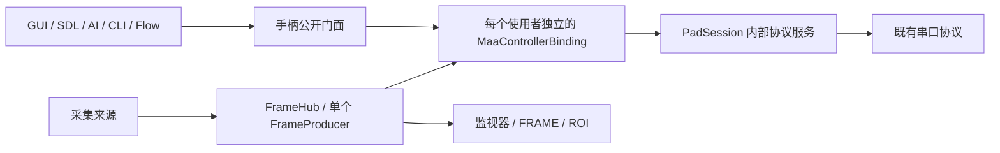

# Maa P1 宿主底座

实施基线：上游 dev `d00b9284b8d835f91166c96a393031e3d7ff06c1`。按 2026-10-16 更新后的实施任务书落地 P1，运行依赖固定为 Maa native **5.14.3** / C# binding **5.10.0**。

## 范围

P1 接通手柄、帧源、设备门面、运行取消及资源所有权。ECS、IL、Flow 文件格式和编译器/VM 保持原样。标签仍使用既有 `ImgLabel.Search`，GUI 截断、CLI 向上取整；OCR 仍使用原后端。P2 将接入资源转换、Maa 识别器和旧评分适配，当前不宣称旧识图链路已经迁移。

## 模块与停止域



| 对象 | 所有权与边界 |
|---|---|
| `MaaHostSession` | 应用组合根；并列持有输入、采集和运行服务 |
| `PadSession` | 独占物理协议连接、连接代次及输入所有者；不引用采集或 Maa native |
| `FrameHub` | 独立采集连接、生产者和帧存储；不引用手柄模块 |
| `MaaControllerBinding` | 固定输入所有者/epoch 和可选帧源代次；只拥有自己的 native 对象 |
| `HostRunScope` | 按需登记输入/实时采集依赖；已有图片的计算不登记采集依赖 |
| `CapabilityLease` | 逐项管理 OCR/推理资源；新建默认资源始终由创建方释放 |

手动输入的接受队列有 256 项上限，后台串行执行 Maa Shell。满队列会清掉尚未执行的手动事件并执行中性收尾，避免留下丢失的释放事件。脚本/Flow 的长按使用可直接取消的 pulse。

停止先取消业务入口，再停止当前绑定的 Tasker、排空回调、经 Inactive 释放输入并确认中性报告写出，最后转交 epoch。写出确认来自实际连接的 `BytesSent`，不表示游戏已执行。掉线记录 `ReleaseUnconfirmed`，重连成功并确认中性报告后才恢复输入。

独立预览使用只截图绑定，Stop/Inactive/Dispose 不写手柄。手动连接保持与运行借用分开：结束任务归还自己的租约，保留用户连接。切换/断开模块会取消并等待其依赖者；另一个模块独立运行。阻塞采集 Read 超时后保留原生产者身份和句柄，迟到帧不发布，不启动第二个生产者。

## 帧与配置

帧槽一起发布像素、frameId、sourceEpoch、宿主到达时间、原始/规范尺寸和 normalizationId。统一输出 BGR8、1920×1080；非 16:9 需显式裁剪或旋转。PNG 桥接不传递跨库 Mat 指针，整帧 PNG 只在帧槽缓存一份。

Windows GUI 来源按 DirectShow 枚举并用 DevicePath/moniker 身份重新解析。macOS 使用 AVFoundation，将 Video 与 Muxed 设备合并并按 `uniqueID` 升序排列，与锁定的 OpenCvSharp5 5.0.0.20261011（OpenCV `40738fb`）索引规则一致；显示 `localizedName`，保存稳定 `uniqueID`，枚举不打开设备。Linux V4L2 优先使用 `/dev/v4l/by-id`；缺少稳定身份的选择标为临时，不能跨进程启动当作稳定 ID 使用。同名显示项不覆盖；未知/消失的来源不回退 0 号。未提供可核实枚举映射的 GUI 后端明确失败。CLI 显式数字序号按指定后端的当前地址解释，并记录临时来源及实际后端。

macOS 的 GUI 后端选项为 `ANY` / `AVFOUNDATION`，Linux 为 `ANY` / `V4L2`；选择与配置恢复共用平台规则。macOS 首次连接会触发摄像头授权，允许后重新连接；拒绝或受限制时，日志会提示系统设置中的摄像头权限入口。`.app` 已包含 `NSCameraUsageDescription`，请使用完整应用包启动 GUI。

两侧选择独立存入 GUI 配置；CLI `run ... --profiles <JSON>` 读取同样的字段。以下是手写临时索引配置的最小例子：

```json
{
  "controller_profile": { "endpoint": "COM3", "transport": "Serial" },
  "capture_profile": {
    "index": 0,
    "backend": "DSHOW",
    "normalization": { "crop": null, "rotation": 0, "interpolation": 0 }
  }
}
```

`--port/-p` 只覆盖输入；`--device/-d` 仍是采集序号；`--videotype/-vt` 是采集后端。改变后端不能沿用另一后端的枚举地址，需显式重新选序号。运行保存实际端点/后端/代次快照，后续修改下拉框不改活动绑定。

## 原生诊断与复验

```powershell
dotnet build EasyCon2.slnx -c Debug
dotnet test EasyCon2.slnx -c Debug --no-build
dotnet format --verify-no-changes --no-restore
dotnet run --no-build -c Debug --project src/EasyCon2.CLI -- maa doctor
```

`maa doctor` 不连接硬件；它检查真实 native 版本、有效 bootstrap、无控制器 Tasker、显式图片识别和 PNG 像素往返，并在 Windows 输出已加载库的位置。发行目录也可直接运行 `EasyCon2.CLI.exe maa doctor`，用于排除开发目录依赖。

bootstrap 不含模型，显式指定 CPU。对照探针发现重复加载默认 Auto 资源会触发推理设备初始化并持续增加私有内存；CPU bootstrap 避开此初始化。它不规定 P2 模型资源的推理后端。实现依据是 [ResourceMgr 的加载与推理设备选择](https://github.com/MaaXYZ/MaaFramework/blob/v5.14.3/source/MaaFramework/Resource/ResourceMgr.cpp)。

`MaaHostTests` / `FrameFoundationTests` 覆盖真实 Maa + fake IConnection / 可控帧源：最终 HID、长按取消、中性写出、旧回调、双端点×双来源、独立停止、采集/输入掉线、帧租约、PNG/stride/alpha、临时身份与配置保存。1000 次短运行记录完整 GC 后内存、线程、native 绑定与帧租约，检查预热后增长上限。C VM 的 C99/32 位/64 位门禁继续保留。

运行报告写入本机应用数据目录 `EasyCon/run-reports/`，最多保留 128 份，包含业务状态、native 状态、错误、兼容 profile、有效配置和清理结果。Maa binding 的 `GetInfo` 中未绑定模块状态为 null，绑定能力与就绪状态单独列出，不能用作应用总连接开关。

## 后续验收

真实串口/采集卡热插拔、驱动 Read 阻塞、游戏反馈时序和 30 分钟业务任务仍需实机验收；macOS/Linux 的实际发行包需分别验证。P2 标签/OCR 样本与分数适配、P3 RunEcs、P4 Pipeline 推进 Flow、P5 完整任务面板/发行验收仍按任务书分批交付。
